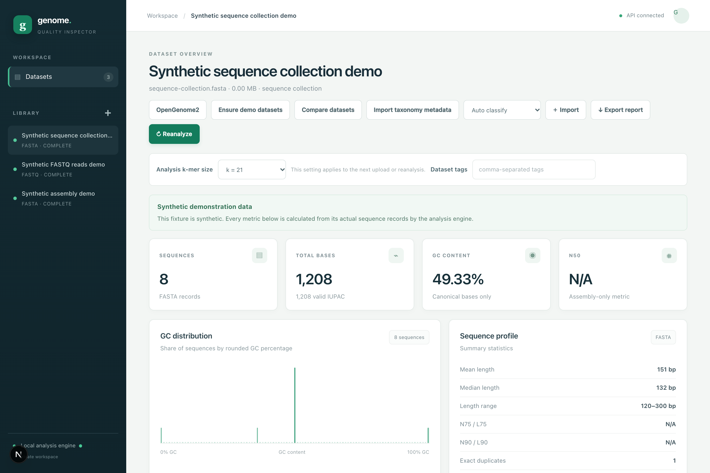
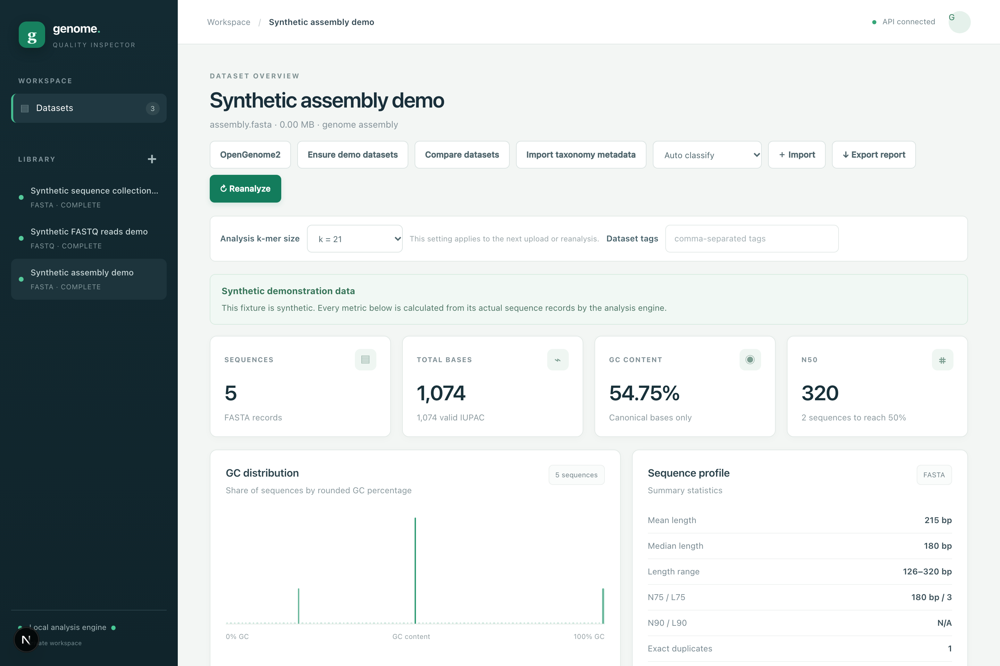
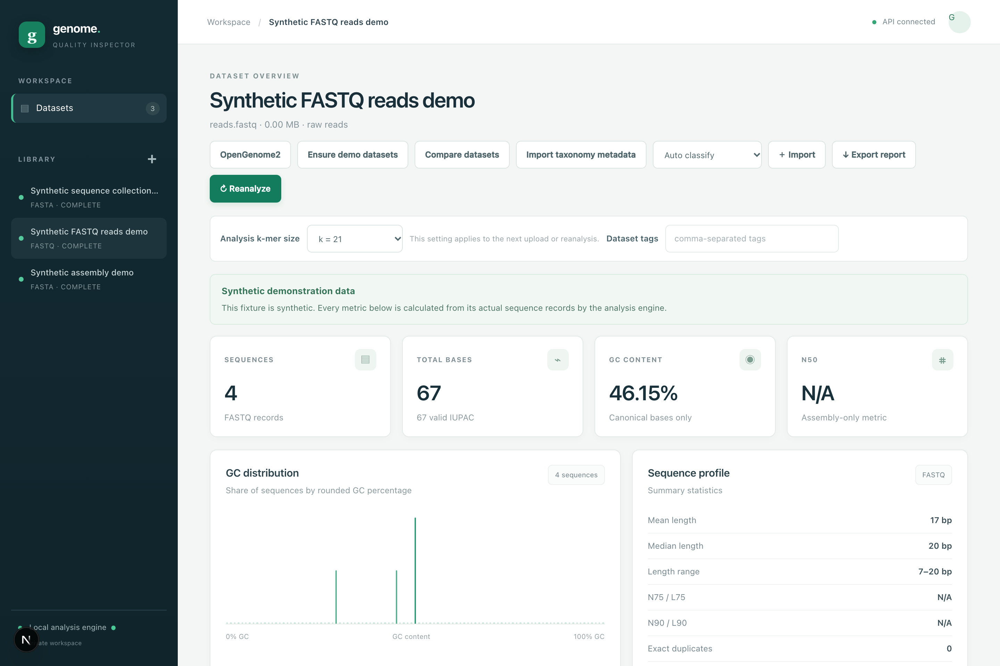
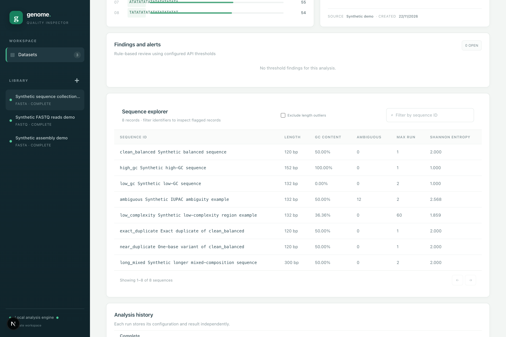
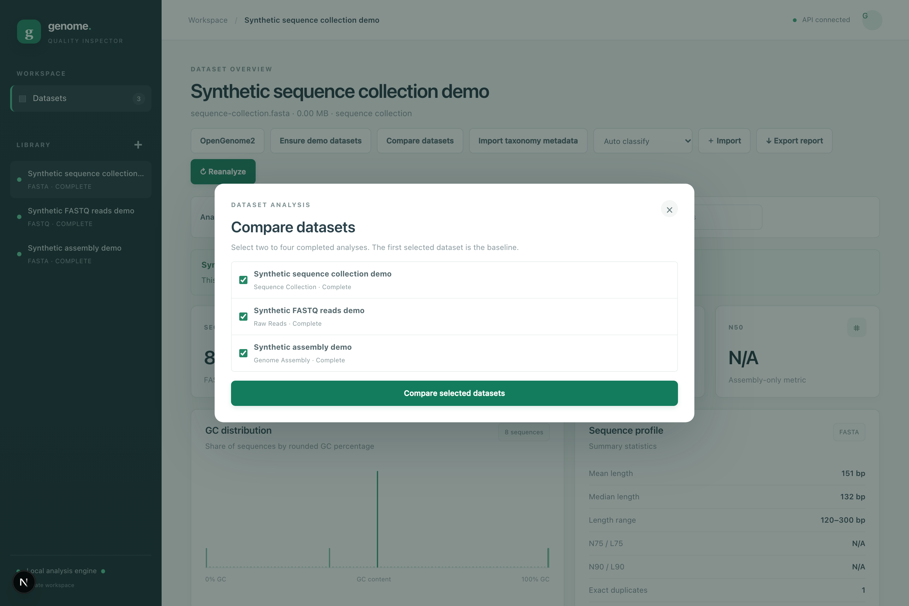
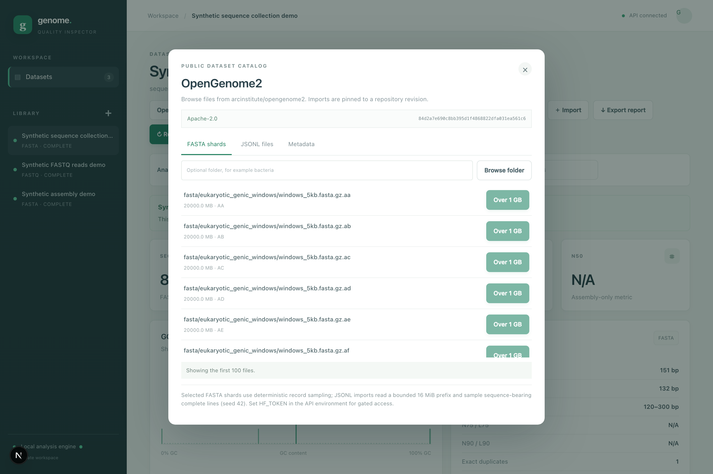
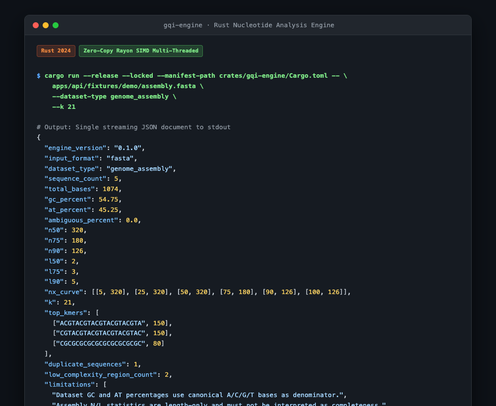

# Genome Quality Inspector

Local-first, reproducible quality auditing application for nucleotide FASTA and FASTQ datasets. A high-performance Rust engine processes sequence records in memory with parallelized Rayon SIMD iterators; a FastAPI backend coordinates persistence, findings, and schema migrations; and a responsive Next.js web application visualizes composition, contiguity, and quality metrics in real time.



---

## The Problem It Solves

High-throughput sequencing and genomic assembly pipelines frequently ingest massive FASTA and FASTQ files with unverified quality characteristics. Undetected sequence duplication, IUPAC ambiguity, low-complexity entropy traps, homopolymer runs, or Phred quality degradation skew downstream variant calling, assembly scaffolding, and machine learning models.

Genome Quality Inspector gives bioinformaticians, ML practitioners, and genomic core labs an immediate, transparent, and completely offline auditing workspace that operates locally without sending genomic data to third-party cloud services.

---

## Key Features

- **Multi-Format Ingestion**: Native parsing for FASTA (`.fa`, `.fasta`, `.fna`, `.ffn`) and FASTQ (`.fq`, `.fastq`), including direct `.gz` stream decompression.
- **Fast Rust Analytics Engine**: Thread-pool parallelized computation of sequence counts, canonical A/C/G/T composition, GC/AT ratios, length percentiles, and exact duplicate detection.
- **Read-Quality Phred+33 Analytics**: Cycle-by-cycle Phred distribution, per-position base quality, and Q20/Q30 accuracy metrics for FASTQ reads.
- **Assembly Contiguity Statistics**: Strict N50, N75, N90, L50, L75, L90 metrics and interactive Nx cumulative curves for explicitly designated assembly datasets.
- **Sequence Entropy & Complexity Auditing**: Sliding-window Shannon entropy analysis with configurable bit thresholds to pinpoint homopolymers and low-complexity regions.
- **Canonical K-Mer Profiling**: Tunable k-mer counting ($k=21$ by default) with k-mer frequency spectra and GC heatmaps.
- **Interactive Multi-Dataset Comparison**: Side-by-side comparative views highlighting composition drifts, contiguity deltas, and quality divergences.
- **Upstream OpenGenome2 Exploration**: Integrated catalog browser for remote OpenGenome2 FASTA shards, JSONL partitions, and taxonomy metadata schemas.
- **Flexible Deployment**: Zero-dependency SQLite storage for immediate local use, with support for PostgreSQL, Alembic migrations, and Redis/RQ background workers.
- **Strict Scientific Boundaries**: Explicitly labels synthetic fixtures, treats N/L contiguity as structural length rather than completeness, and separates IUPAC ambiguity from non-nucleotide errors (see [Scientific Limitations](docs/scientific-limitations.md)).

---

## Visual Tour & Interface Gallery

### Assembly Contiguity Dashboard (N50 / L50 / Nx Curve)

Evaluates scaffold and contig length distributions, displaying cumulative Nx curves alongside N50, N75, and N90 metrics.


### FASTQ Read Quality & Phred Profiles

Visualizes per-cycle nucleotide composition, mean Phred quality curves, and Q20/Q30 compliance for raw sequencing reads.


### In-Depth Sequence & Entropy Inspection

Explores individual sequence records with per-contig GC percentage, Shannon entropy, homopolymer run detection, and low-complexity regions.


### Multi-Dataset Comparative Analysis

Side-by-side diffing across assemblies, read libraries, and sequence collections with automated variance warnings.


### OpenGenome2 Catalog Browser

Preview remote partitions, download bounded JSONL portions, and examine source metadata schema directly within the workspace.


### High-Performance Rust CLI

The standalone Rust engine (`gqi-engine`) streams detailed JSON analysis documents directly to stdout in milliseconds.


---

## Built-In Demo

The application comes bundled with three validated synthetic fixtures in [`apps/api/fixtures/demo/`](apps/api/fixtures/demo/). Launching the application and clicking **Load sample datasets** allows immediate exploration without needing external files:

| Fixture                 | Format | Records | Bases | Key Calculated Metrics                                  |
| :---------------------- | :----- | ------: | ----: | :------------------------------------------------------ |
| **Sequence Collection** | FASTA  |       8 | 1,208 | GC 49.33%; 1 exact duplicate; IUPAC ambiguities parsed  |
| **Read Quality**        | FASTQ  |       4 |    67 | Mean Phred 30.0; Q20 92.54%; Q30 62.69%                 |
| **Genome Assembly**     | FASTA  |       5 | 1,074 | GC 54.75%; N50 320 bp; L50 2 contigs; Nx curve computed |

_All fixtures are synthetic and clearly marked in the UI to prevent conflation with biological observations._

---

## Architecture

The project is structured as a modular monorepo:

```
genome-quality-inspector/
├── crates/
│   └── gqi-engine/         # High-performance Rust CLI & sequence analytics engine
├── apps/
│   ├── api/                # FastAPI backend service, SQLite/PostgreSQL models & Alembic migrations
│   │   ├── gqi_api/        # API endpoints, background workers, and integration handlers
│   │   ├── fixtures/demo/  # Synthetic FASTA and FASTQ test fixtures
│   │   └── migrations/     # Database migration scripts
│   └── web/                # Next.js 16 (React 19) App Router web interface
├── data/                   # Default local storage for SQLite database and uploads
└── docs/                   # Architecture, metrics definitions, and scientific limitations
    └── screenshots/        # Application showcase images
```

---

## Requirements

- **Rust toolchain**: 1.85+ with `cargo`
- **Python**: 3.11+ with [`uv`](https://github.com/astral-sh/uv)
- **Node.js**: 20+ with [`pnpm`](https://pnpm.io/)
- _Optional_: Docker Compose for production PostgreSQL and Redis execution

---

## Quick Start

### 1. Build the Rust Analysis Engine

```bash
cargo build --release --locked --manifest-path crates/gqi-engine/Cargo.toml
```

The compiled binary will be located at `crates/gqi-engine/target/release/gqi-engine`.

### 2. Start the FastAPI Service

```bash
cd apps/api
uv sync --locked
uv run alembic upgrade head
GQI_ENGINE=../../crates/gqi-engine/target/release/gqi-engine uv run uvicorn gqi_api.main:app --reload --port 8000
```

Interactive OpenAPI documentation is available at `http://localhost:8000/docs`.

### 3. Start the Next.js Web Application

In a separate terminal:

```bash
cd apps/web
pnpm install --frozen-lockfile
pnpm dev
```

Open [http://localhost:3000](http://localhost:3000) in your browser. Click **Load sample datasets** to populate the workspace.

---

## CLI Usage

The analysis engine can be executed directly as a standalone CLI tool on any FASTA or FASTQ file:

```bash
cargo run --release --locked --manifest-path crates/gqi-engine/Cargo.toml -- \
  path/to/sample.fasta \
  --dataset-type genome_assembly \
  --k 21
```

Supported `--dataset-type` flags:

- `sequence_collection` (default for FASTA)
- `raw_reads` (default for FASTQ)
- `genome_assembly` (computes N/L contiguity metrics and Nx curves)
- `reference_genome`
- `training_corpus`
- `unknown`

The engine outputs a single structured JSON document to stdout, ideal for bioinformatics pipelines and shell redirection:

```bash
gqi-engine assembly.fasta --dataset-type genome_assembly | jq '.n50, .gc_percent'
```

---

## API Reference

The backend provides versioned RESTful `/api/v1` routes alongside standard `/api` compatibility endpoints:

| Endpoint                                | Method | Description                                                       |
| :-------------------------------------- | :----- | :---------------------------------------------------------------- |
| `/api/health`                           | `GET`  | Health status and engine path verification                        |
| `/api/v1/capabilities`                  | `GET`  | Supported formats, algorithms, and optional CLI tool availability |
| `/api/v1/datasets`                      | `GET`  | List persisted datasets with pagination and query filtering       |
| `/api/v1/datasets`                      | `POST` | Upload single or multi-file datasets (`multipart/form-data`)      |
| `/api/v1/datasets/{id}`                 | `GET`  | Retrieve dataset metadata and computed analysis JSON              |
| `/api/v1/datasets/{id}/analyze`         | `POST` | Re-run engine analysis with custom parameters (e.g. custom $k$)   |
| `/api/v1/datasets/{id}/sequences`       | `GET`  | Paginated sequence record inspection with length/outlier filters  |
| `/api/v1/datasets/{id}/sequence-window` | `GET`  | Fetch bounded sequence window for sequence-level inspection       |
| `/api/v1/datasets/{id}/findings`        | `GET`  | Retrieve and acknowledge automatic quality findings               |
| `/api/v1/comparisons`                   | `POST` | Execute multi-dataset comparative metric calculations             |
| `/api/v1/demo/seed`                     | `POST` | Seed the built-in synthetic demonstration fixtures                |
| `/api/v1/datasets/{id}/report`          | `GET`  | Export complete analysis report as downloadable JSON              |

---

## Configuration

Environment variables can be configured via a `.env` file in the repository root:

| Variable               | Default                                       | Description                                                  |
| :--------------------- | :-------------------------------------------- | :----------------------------------------------------------- |
| `DATABASE_URL`         | `sqlite:///data/gqi.sqlite3`                  | SQLAlchemy database URL (SQLite or PostgreSQL)               |
| `GQI_DATA_DIR`         | `./data`                                      | Directory for uploads and local SQLite database              |
| `GQI_ENGINE`           | `crates/gqi-engine/target/release/gqi-engine` | Absolute or relative path to the compiled engine binary      |
| `GQI_MAX_UPLOAD_BYTES` | `5368709120` (5 GiB)                          | Maximum allowable file upload size                           |
| `GQI_CORS_ORIGINS`     | `http://localhost:3000,http://127.0.0.1:3000` | Comma-separated list of allowed CORS origins                 |
| `GQI_REDIS_URL`        | _None_                                        | Optional Redis connection string for durable background jobs |
| `NEXT_PUBLIC_API_URL`  | `http://localhost:8000`                       | Backend API URL accessed by the Next.js frontend             |

---

## Verification & Testing

Run all unit tests, linters, and type checkers across the stack:

```bash
# 1. Rust engine tests, formatting, and clippy
cargo fmt --manifest-path crates/gqi-engine/Cargo.toml --check
cargo test --locked --manifest-path crates/gqi-engine/Cargo.toml
cargo clippy --locked --manifest-path crates/gqi-engine/Cargo.toml --all-targets -- -D warnings

# 2. FastAPI backend tests, linting, and mypy
cd apps/api
uv run pytest
uv run ruff check gqi_api tests migrations
uv run mypy gqi_api

# 3. Next.js web application linting and type checking
cd ../web
pnpm exec tsc --noEmit
pnpm lint
pnpm build
```

---

## Scope & Scientific Limitations

Please consult [`docs/scientific-limitations.md`](docs/scientific-limitations.md), [`docs/metrics.md`](docs/metrics.md), and [`docs/architecture.md`](docs/architecture.md) for detailed metric definitions:

- **Contiguity is not Completeness**: N50, N75, and L statistics measure sequence assembly contiguity only; they do not indicate biological completeness, gene coverage, or lack of misassemblies.
- **IUPAC Symbol Separation**: Ambiguous bases (R, Y, S, W, K, M, B, D, H, V, N) are distinguished from illegal non-IUPAC characters. GC calculations explicitly use canonical bases in the denominator.
- **In-Memory Operations**: The analysis engine processes records and results in memory; ensure sufficient system RAM when evaluating multi-gigabyte files.
- **Offline Classification**: External taxonomy classification (GTDB/NCBI) requires optional CLI tools or user-supplied metadata tables.

---

## Contributing

Contributions, bug reports, and pull requests are welcome! Please review [CONTRIBUTING.md](CONTRIBUTING.md) and [CODE_OF_CONDUCT.md](CODE_OF_CONDUCT.md) before submitting code.

---

## License

This project is licensed under the [MIT License](LICENSE).
